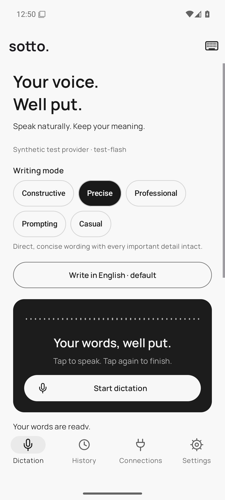
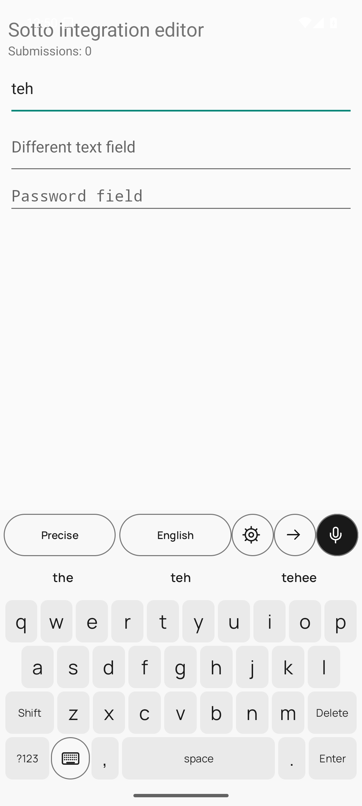
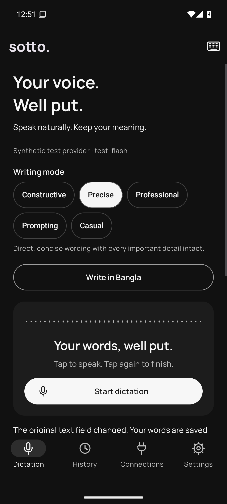

# Sotto for Android

**Your voice. Well put.**

Dictate in Bangla, English, or mixed languages, choose a writing mode, and insert the finished text into your active text field from the Sotto voice keyboard.

**Android 8.0+ · Native app · Five writing modes · Direct AI connections · Local history**

[Download the Android APK](https://github.com/MEmio3/Sotto_Phone/releases/latest) · [Source repository](https://github.com/MEmio3/Sotto_Phone)

The mobile project lives in `E:\SottoApk`. The desktop app stays in `E:\Sotto`.

| Dictation | Typing and voice keyboard | Dark appearance |
| --- | --- | --- |
|  |  |  |

These are native Android emulator captures using a clearly labeled synthetic test provider, not a bundled AI account.

## Install and start

1. Download [Sotto-0.1.0-Android.apk](https://github.com/MEmio3/Sotto_Phone/releases/latest/download/Sotto-0.1.0-Android.apk), transfer it to your phone, and install it. Android may ask you to allow installation from the app opening the APK.
2. Open **Connections → Add API**. Add a Gemini API key or a compatible API connection. Get a Gemini key from [Google AI Studio](https://aistudio.google.com/apikey). Experimental Google sign-in is also available.
3. Open **Models**, choose an available model, and tap **Use model**, then **Test**. Test verifies text generation; the first dictation checks audio support.
4. In **Settings**, allow microphone access, enable **Sotto voice keyboard** in Android's keyboard settings, then select it.
5. Tap a text field in another app. Tap **Start dictation**, speak, then **Finish dictation**. Your finished text is inserted automatically. The message is never submitted automatically.

Use the keyboard-switch icon to return to your usual keyboard. You can also record and polish typed text inside the Sotto app.

## A keyboard for typing and voice

Sotto has its own familiar QWERTY layout with Shift, Caps Lock, symbols, Space, Delete and Enter. The microphone is at the top right. It is a Sotto keyboard, with no Gboard installation or Google keyboard service required.

**Settings → Typing & suggestions** has independent switches for **Show word suggestions** and **Autocorrect words**. Offline English spelling uses a bundled dictionary. Tap a suggestion to complete a word. Autocorrect applies at Space or punctuation; immediately press Backspace to restore what you typed. Suggestions and corrections stay disabled in password, email, URL and no-suggestions fields. Typing works without an AI connection or internet access. Spelling is English-only in this version; voice output supports other languages through your selected model.

**Settings → Language shortcuts** lets you add, edit or remove letter-to-language mappings and disable shortcuts entirely. Defaults are **B → Bangla** and **E → English**. Tap the microphone, then a mapped letter while recording to choose the output language. You can assign any A–Z letter to a language name. The letter is consumed as a recording command; ordinary typing still types the letter normally. The language button and optional spoken language cues remain available.

## Writing modes

| Mode | How it writes |
| --- | --- |
| **Constructive** | Considerate, actionable feedback without invented suggestions. |
| **Precise** | Direct wording with important details intact. The default. |
| **Professional** | Clear, respectful language for work and formal messages. |
| **Prompting** | A clear instruction for another AI, without answering it. |
| **Casual** | Relaxed, natural messages without added slang or emojis. |

Your choice stays saved and applies to recordings, typed text and **Rework**. Modes are locked during a dictation. Saved results show the mode used. **Settings → Your writing preferences** adds your own style guidance.

## Languages and recognition

Polished English is the default. Select Bangla, English, Same as speech, or another output language. With spoken language cues enabled, say **“write this in Bangla”** or request another language. An explicit selection takes priority. You can change the language while recording, before processing begins.

- **Selected provider:** captures a WAV locally, then sends it to your chosen provider for transcription and editing. Gemini can do both in one request. Compatible APIs use their transcription endpoint, then their chat endpoint.
- **On-device recognition:** requires Android 12+ and an available device speech service/language model. The transcript still goes to your selected AI for editing. There is no silent cloud-recognition fallback when the device recognizer is unavailable.

The original transcript stays alongside the finished text. Each mode asks the AI to preserve names, numbers, negations and meaning. Accuracy depends on the microphone, recognizer, model and spoken content.

## Direct insertion

Android uses a voice keyboard in place of the desktop shortcut. Sotto uses Android's [input-method framework](https://developer.android.com/develop/ui/views/touch-and-input/creating-input-method) and `InputConnection.commitText` to deliver text.

- No clipboard paste step or accessibility service is required.
- Recording starts only after you tap the microphone.
- A changed editor keeps the result available for review.
- Voice dictation is disabled in password fields.
- Ordinary keyboard input is not logged or sent to an AI. The current word is inspected locally for spelling when enabled.
- Unclear results remain available to review before insertion.

Results recorded inside the main app have a **Copy text** action. Use the Sotto keyboard for automatic insertion into another app.

## Google / Antigravity

**Connect Google** opens your system browser. The experimental connector uses desktop Sotto's community protocol and published installed-client configuration. It keeps the phone's OAuth session locally and needs no OmniRoute server or PC Antigravity session. **Models** fetches the account's live Flash catalog; access and quotas belong to the account.

> **Use this unofficial connection at your own risk.** Google may reject the integration, stop access or restrict an account. API connections work independently.

Mobile browser sign-in and real-account access still need physical-device verification. This compatibility OAuth flow currently lacks PKCE. Published client defaults do not establish Google's approval of third-party reuse. See [OAuth configuration](docs/OAUTH-CONFIGURATION.md).

## Privacy and recovery

API keys and login tokens are encrypted with **Android Keystore** and AES-GCM. History and retained recordings live in app-private storage. Android app backup is disabled. No Sotto server receives your data and no analytics SDK is included.

Your chosen provider receives the audio or transcript needed for each dictation. On-device speech recognition still uses your AI connection for polishing.

Completed audio is deleted by default. When history is enabled, failed recordings can be retained for retry. **History** supports Unicode search, original/final text, retained-audio playback, rework, export and deletion. With history disabled, failed work can only be retried while its in-memory job remains available.

## Build an APK

Requirements: JDK 17+, Node.js 18+ for setup/signing helpers, Android SDK 36. Gradle 8.14.3 is supplied through the wrapper. A phone needs none of these development tools.

Run **Build Sotto APK.cmd**, or:

```powershell
powershell -NoProfile -ExecutionPolicy Bypass -File scripts/build-apk.ps1
```

The helper uses a configured Android SDK, or downloads a project-local SDK from Google if needed. It runs unit tests and creates:

```text
dist/Sotto-0.1.0-Android.apk
dist/SHA256SUMS.txt
```

The release APK uses a project-local signing key. **Privately back up `.signing/` and `signing.properties`** to sign future updates. Both are excluded from source control and the APK. A differently signed APK cannot update the existing installation.

Development checks:

```powershell
.\gradlew.bat :app:testDebugUnitTest
.\gradlew.bat :app:assembleDebug :app:assembleDebugAndroidTest
```

The optional prompt-sync helper refreshes prompt data from the desktop source. Normal builds use the bundled JSON and require no desktop Sotto installation.

## Verification

See [verification notes](docs/VERIFICATION.md) for build results, native emulator tests, UI review and remaining device/account limits. Emulator audio checks use synthetic test data and a local mock provider; they do not establish real recognition accuracy.

## Credits

Created by **MEmio3** · [maruf.hossain1@g.bracu.ac.bd](mailto:maruf.hossain1@g.bracu.ac.bd)

MIT licensed. Native Android Views, Material Components and AndroidX, with Manrope lettering. The unofficial account connector references OmniRoute. See [third-party notices](THIRD_PARTY_NOTICES.md). Sotto is independent and is not endorsed by Google or OmniRoute.
